<div align="center">



<br/>


<a href="https://github.com/AryanDas20?tab=followers"></a>


<br/><br/>

<a href="https://www.linkedin.com/in/aryandas-iit/"></a>
<a href="https://syneq.vercel.app/"></a>
<a href="https://aryandas.netlify.app"></a>
<a href="https://leetcode.com/u/aryandas_2005/"></a>

<br/><br/>


</div>

<br/>

## `> about --me`

My journey into tech began in **5th grade** and turned into a deep technical pursuit by **age 12**. Since then I've been mastering the building blocks of the web (**HTML, CSS, PHP, JavaScript**) and their modern frameworks to build functional, design-forward projects.

Right now I'm pursuing **two degrees at once**: a **B.Tech in Computer Science at Lovely Professional University** and an **Integrated BS-MS in CS at IIT Patna**, merging theoretical depth with practical engineering. I'm also a **GCI World 2026** participant at **The University of Tokyo** (AI and Data Science), and the **founder of SyneqTech**.

<div align="center">

</div>

<div align="center"></div>

## `> tech --orbit`

<div align="center">


<br/>


</div>

<div align="center"></div>

## `> projects --live`

<div align="center">

<table>
<tr>
<td width="50%" valign="top">

### 🛒 UniTrade
College-gated student marketplace (buy, sell, rent, barter). Built solo at **Hackyard BUILD 2026, IIT Guwahati**.

 

[**Live Demo →**](https://neotradeuni.vercel.app/)

</td>
<td width="50%" valign="top">

### 🗄️ VAULT v4.0 Distributed
Distributed object-storage engine dashboard with a live node cluster view. Built for **Prompt-a-Thon**.

 

[**Live Demo →**](https://promptathon-eight.vercel.app) · [**Repo →**](https://github.com/AryanDas20/Promptathon-project)

</td>
</tr>
<tr>
<td width="50%" valign="top">

### 🌍 PlanetPulse
Carbon footprint tracker with streaks, weekly targets and a forecast. **Code2Career** solo project (round finalist).

 

[**Live Demo →**](https://planetpulse-theta.vercel.app)

</td>
<td width="50%" valign="top">

### 📈 StockSense
Describe your stock in plain words and it keeps the ledger. Built with AI tools.

 

[**Live Demo →**](https://stocksense-jade-nu.vercel.app)

</td>
</tr>
<tr>
<td width="50%" valign="top">

### 🏋️ OrbitX
AI workout trainer, made in my first B.Tech semester.

 

[**Live Demo →**](https://xorbit-ruby.vercel.app)

</td>
<td width="50%" valign="top">

### ⚡ DevStorm 2k26
36-hour hackathon build at LPU (Team Spirit x SyncGaze).

 

[**Repo →**](https://github.com/AryanDas20/DevStorm-Project-2k26)

</td>
</tr>
</table>

</div>

<div align="center"></div>

## `> timeline --journey`

<div align="center">

</div>

<div align="center"></div>

## `> git stats --live`

<div align="center">


<br/>


<br/>


<br/><br/>


</div>

<div align="center"></div>

## `> snake --eat-contributions`

<div align="center">
<picture>
  <source media="(prefers-color-scheme: dark)" srcset="https://raw.githubusercontent.com/AryanDas20/AryanDas20/output/github-snake-dark.svg" />
  <source media="(prefers-color-scheme: light)" srcset="https://raw.githubusercontent.com/AryanDas20/AryanDas20/output/github-snake.svg" />
  
</picture>
</div>

<div align="center"></div>

## `> certifications --verified`

| Program | Issuer | Year |
|---|---|---|
| 🔐 Cybersecurity Fundamentals | IBM | 2026 |
| 🐍 Programming in Python | Meta | 2026 |
| 🤖 AI Tools Workshop | Be10x | 2026 |
| 🧮 AI in Accounting 101: CAIRA Essentials | Miles Education | 2026 |
| 🧠 Machine Learning | University of London | 2020 |
| 🌐 Front-End Web Dev, Advanced Styling, JavaScript (4 courses) | University of Michigan | 2020-21 |
| 🛰️ Cyberspace Competition | ISRO | 2020 |
| 🧒 AI for Youth Symposium | Intel | 2020 |

## `> hackathons --2026`

```diff
+ Hackyard BUILD 2026       | IIT Guwahati        | solo developer, UniTrade
+ Code2Career AI Hackathon  | Coding Ninjas       | round finalist, solo
+ Hackoverflow 10.0         | NIT Durgapur        | participant
+ IIT Madras x Romeo Juliet | ML hackathon        | "The Sequential Matching Problem"
+ Prompt-a-Thon             | Launch Crew         | VAULT v4.0
+ LPU AgentIQ Datathon      | Pickl.AI            | participant
+ DevStorm 2026             | LPU, 36 hours       | participant
+ Code Flux 2026            | CodingBlocks LPU    | hackathon + 2 seminars
```

## `> roadmap --current`

```diff
+ [DONE]   HTML, CSS, JavaScript, PHP, SQL foundations
+ [DONE]   8+ hackathons, shipped live projects on Vercel and Netlify
+ [DONE]   Founded SyneqTech
! [ACTIVE] BS-MS CS at IIT Patna + B.Tech CSE at LPU
! [ACTIVE] GCI World 2026, AI and Data Science at UTokyo
! [ACTIVE] React, Machine Learning, full-stack systems
- [NEXT]   Research and innovation projects in AI/ML
- [NEXT]   Open-source contributions and more Pull Requests
```

<div align="center">


<a href="https://github.com/AryanDas20?tab=achievements"></a>


<br/><br/>

<a href="https://www.linkedin.com/in/aryandas-iit/"></a>
<a href="https://stackexchange.com/users/22134727/aryan-das"></a>

<br/><br/>


</div>
